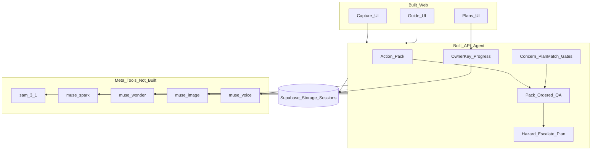
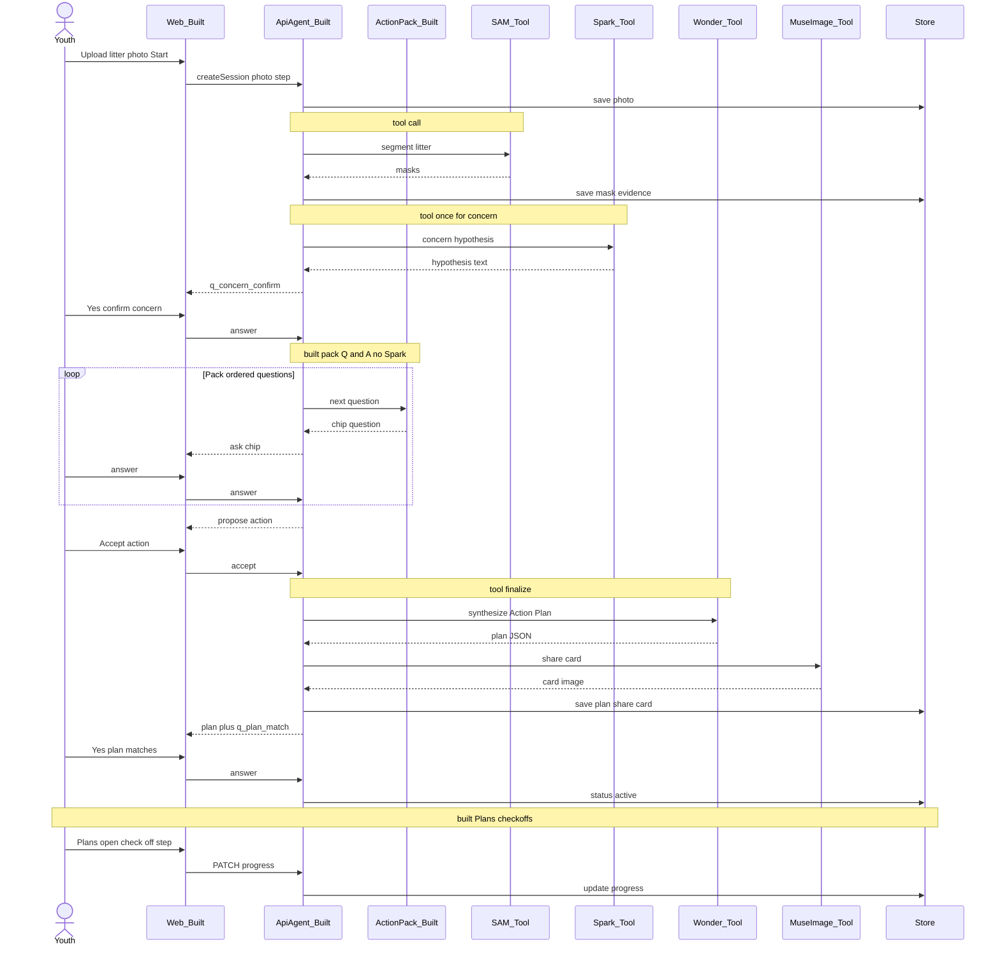
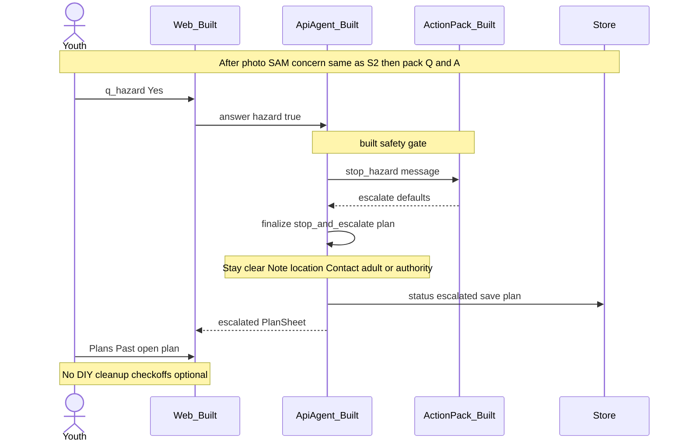

# Iklim PAL — demo diagrams

Copy-paste Mermaid into GitHub / Notion / Obsidian, or screenshot for slides.

**Say once when showing Diagram 1:** “Boxes marked Built = Hackathon code; Meta models are tools we call.”

Use Diagram 1 near open or close; Diagram 2 for the S2 happy path; Diagram 3 for the S4 hazard beat.

---

## 1. High-level architecture

| Layer | Hackathon-built? |
| --- | --- |
| Web Capture / Guide / Plans | Yes |
| Action Pack, pack Q&A, gates, escalate plan, `ownerKey` progress | Yes |
| SAM / Spark / Wonder / Muse Image / Voice | No — tools |
| Supabase buckets + session rows | Infra we wired |

---

## 2. Sequence — happy path (S2 riverbank)

---

## 3. Sequence — hazard escalate (S4)

---

## Demo usage

- **0:00 or 2:30:** Diagram 1 on screen while naming Built vs Meta tools.
- **During S2:** Diagram 2 as a B-roll slide if live UI is slow.
- **During S4:** Diagram 3 when hazard Yes fires.
